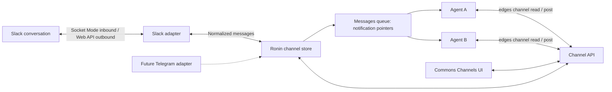

# Persistent channels and external chat adapters

Ronin channels are Team-scoped conversations with stable IDs, independent of session
lifetime. Sessions subscribe using their birth identity. A channel optionally binds to
an external conversation; the first adapter is Slack Socket Mode.

## Ownership and scope

| Surface | Authority |
|---|---|
| Channel record, subscriptions, cursors, outbox | `src/channels.ts` |
| Browser and Agent API | `src/routes/channels-api.ts` |
| Shared operator client and post-output acknowledgement | `src/channel-cli.ts`, `src/cli-http.ts` |
| Slack protocol, credentials in memory, reconnect | `src/slack-channel.ts` |
| Startup, shutdown, live session identity, delivery queue | `src/channels-runtime.ts`, `src/index.ts` |
| Notification pointer transport and birth-key guard | `src/message-queue.ts`, `public/js/message-queue.js` |
| User-store and development-socket registration | `src/resources.ts`, `src/operator-socket.ts` |
| Commons controls and responsive presentation | `public/js/team-channels.js`, `public/css/team-workspace.css`, composed in `cowork-view.js` |
| Labels, command projection, and Agent teaching | `ronin_catalogs/lexicons/professional_en.md`, `ronin_bin/edges`, `ronin_catalogs/TOOLS.md`, `ronin_catalogs/capabilities/edges.md` |
| Slack app template, setup, and live acceptance | `docs/assets/slack-channel-manifest.json`, `docs/using-ronin/channels.md` |

These are core Cowork modules. The Slack adapter is opt-in through an operator credential
file; it is not a Ronin Services part, and does not modify generated `src/services/`.
The provider-neutral contract allows another adapter without copying channel state or
Agent tools. A future Services adapter can implement the same contract through an
explicit registration hook; this version does not add such a Services hook.

Team scope controls discovery and subscriber membership. Channel IDs are unique within
one operator. A channel does not disappear when all its subscribers stop. This is distinct
from the temporary Team Wipeboard, the pending terminal message queue, and the UI's
generic “Channel Surface” tab container.

## Public model and validation

The two identifiers in the UI are deliberately different:

| Value | Example | Rule |
|---|---|---|
| Ronin channel ID | `customer-support` | Operator-wide unique handle; 1–64 lowercase letters, numbers, hyphens, or underscores; begins with a letter or number |
| Display name | `Customer support` | Human-facing title; required; at most 160 characters |
| Slack conversation ID | `C0123456789` or `G0123456789` | Provider-owned destination; uppercase `C…`/`G…`; must be in the configured workspace and contain the bot |
| Message text | — | Non-blank; at most 12,000 characters |

The browser asks for the display name first, derives a slug until the ID is manually
edited, labels the ID as a Ronin command handle, and rejects a pasted Slack ID before
creation. The server repeats all authoritative validation. A Slack conversation can be
bound to only one Ronin channel, and this release permits only one external binding on
each Ronin channel.

Subscriptions belong to an exact live session birth: `{session name, birth key}`. Every
subscription grants reading, while `write` independently permits explicit posts and
`notify` independently requests Messages-queue pointers. Team membership is checked at
subscription, read, post, and notice-delivery time. Reusing a session name after a
replacement does not inherit the old birth's authority or cursor.

## State and concurrency

The `channels` user store contains `<id>.json`, version 1. Each record holds title, Team,
archive flag, optional `{provider, workspace, conversation}` binding, subscriptions,
and ordered messages. Subscriptions contain session name, birth key, read/write
permission, notification preference, and a read cursor.

Messages contain an immutable local UUID and increasing sequence, text, author, direction,
timestamp, optional remote message/thread IDs, binding snapshot, pending notification
recipients, and outbound delivery state. Credentials never appear in this store.

One operator owns all writes. Browser and CLI operations run in that same process;
`/api/cli/channel` is registered before the general child-process CLI dispatcher.
Mutations are serialized and saved with mode 0600 through a temporary file and rename.
The directory is created with mode 0700. A second operator must not share this store:
the in-process serialization is not a distributed lock. Atomic rename is crash-safe
against partial JSON replacement, but there is no fsync-based power-loss guarantee.

Inbound deduplication uses the provider/workspace/conversation and remote message ID.
The owner composer uses a stable request UUID across retries of the same draft.
The CLI generates a request UUID for each intentional post. Repeating the command is a
new post. Reader cursors advance monotonically through a separate acknowledgement after
the CLI has written output; a failure can produce a repeated read rather than lost data.

Browser responses never expose pending notice recipients. Channel detail returns only
the newest 100 messages, while the summary returns a total count. The durable store keeps
up to 10,000 messages per channel and refuses the next message rather than silently
discarding history, cursor evidence, or inbound deduplication keys.

## Operator and API surface

`channelRuntime()` is constructed with the other core routes, recovers interrupted
outbound state, loads the optional Slack connector, starts a two-second delivery/notice
sweep, and stops connector timers and sockets during operator shutdown. The persistent
store is the user `channels` store. Development may expose the same authenticated API on
an explicitly configured private `RONIN_DEV_SOCKET`; this never replaces the installed
operator socket. See [operator connection](operator-connection.md).

| Method and route | Owner/browser operation |
|---|---|
| `GET /api/channels?team=…` | Team-filtered summaries and connector status |
| `POST /api/channels` | Create a local Ronin channel |
| `GET /api/channels/:id` | Detail, subscriptions, newest messages, and delivery state |
| `PUT /api/channels/:id/binding` | Validate/connect Slack, or disconnect with `null` |
| `PUT /api/channels/:id/archive` | Archive or restore |
| `PUT/DELETE /api/channels/:id/subscriptions/:session` | Save permissions or unsubscribe |
| `POST /api/channels/:id/messages` | Owner post, optionally replying to a local message ID |
| `POST /api/channels/:id/messages/:message/resolve` | Retry or dismiss retained outbound work |
| `POST /api/cli/channel` | Session-resolved `edges channel` operations |

All routes use the existing `/api` authentication or the mode-0600 local operator
socket. The channel CLI route is registered before the general command dispatcher so
operations execute against the single in-process store owner.

The Commons module is mounted per Team and polls only while its **Channels** tab is
entered. It keeps connector state, the current-channel picker, a collapsible creation
form, separate Slack and Agent-access cards, recent conversation history, delivery
recovery controls, a thread-aware composer, and responsive one-column layouts. Network
failures are presented as transient reconnecting state and cleared after a successful
poll. Owner post retries reuse a browser-generated request UUID so retrying the same
draft does not create a second local message.

## Inbound delivery

1. The Slack adapter establishes identity through `auth.test` and requests a WebSocket
   URL with the app token through `apps.connections.open`.
2. A Socket Mode envelope is checked for workspace identity and supported message type.
   Bot messages and the app's own messages are ignored, preventing echo loops.
3. The adapter normalizes human text, author ID, remote ID, thread, and attachment links.
   Only an active matching channel binding receives the message.
4. The channel commits it, including notification recipients, before the envelope is
   acknowledged. Retry envelopes deduplicate against persisted messages.
5. The sweep sends pointers through `enqueueMessage` with source `channel_notice`.
   Both subscription birth key and current Team membership must match; queue acceptance
   also checks the expected birth key to avoid delivering to a replacement session.
6. Agents use `edges channel read`. Quiet subscribers can read without interruption.

Notifications contain a channel handle and tool instruction, never external message
text. They are delivery hints: read state is in the channel, not the notification queue.
If the operator crashes after queue acceptance but before recording that acceptance, a
duplicate notification pointer is possible. Agent reads still deduplicate by cursor.
Offline/replaced subscribers retain history, but old notices are discarded; newly
subscribed sessions must explicitly read to catch up.

External chat participants do not acquire owner authority. Agent teaching instructs
Agents to interpret messages within their existing assignment and to post explicitly.
This feature does not automatically claim tasks or decide which subscriber should answer.
The ordinary Messages delivery policy determines when a notification pointer reaches a
busy Agent; the channel event itself does not directly type into or stop an Agent.

## Outbound delivery and recovery

Posting commits locally with a binding snapshot. With no binding the post stays local;
connecting later does not retroactively publish local history.
With a binding, it enters the durable outbox as `queued`. The two-second sweep attempts
at most one outbound message per channel. A post transitions to `sending` before network
I/O, then to `sent` with the remote ID.

Known Slack API rejections become `failed`. HTTP 429 responses honor `Retry-After`
(bounded to 1–3600 seconds) and hold that provider's queued sends. Transport failures,
invalid responses, and server errors become `uncertain`, because Slack may have accepted
the post. Restart converts unfinished `sending` entries to `uncertain`.

Only the owner recovery API retries or dismisses failed/uncertain messages. The UI
explicitly warns that retrying an uncertain send may duplicate it. This is not
exactly-once delivery. `client_msg_id` is sent as a correlation ID, not relied on as a
guarantee of deduplication.

Replies resolve a local parent message to its remote thread (or root message ID).
The parent must have a remote ID and the same binding. Binding changes are refused while
any outbound work is unresolved. The remote post includes the Ronin author in plain text;
Slack markup, mention parsing, and link/media unfurls are disabled.

Slack binding validation calls `conversations.info` with a GET query, after `auth.test`
has established the configured workspace and bot identity. Outbound calls use
`chat.postMessage`, prefix text with the Ronin author, and include the local message UUID
as `client_msg_id`. Incoming `message.channels` and `message.groups` events accept human
messages and `file_share`, retain permalink text, and truncate normalized content before
the 12,000-character store limit. Edits, deletions, reactions, bot/self messages, empty
events, other workspaces, and unbound conversations are ignored.

Archive pauses the sweep and inbound ingestion while preserving state. In-flight network
calls can finish after archive is pressed. Disconnect removes the binding after pending
work is resolved. Bot tokens are not revoked by disconnect; several other Ronin channels
may use the same Slack app.

## Transport lifecycle and credentials

`RONIN_SLACK_CREDENTIALS_FILE` names a server-local JSON file with `bot` and `app` keys.
The runtime rejects group/world-readable files. It does not put token values in the
environment, browser APIs, channel records, prompts, or error messages.
Credential rotation requires an operator restart.

Socket Mode reconnects with exponential backoff up to one minute, responds to Slack
disconnect messages, and detects stale sockets using ping/pong. The runtime exposes
configured/connected/workspace/error status. Shutdown stops timers and closes the socket.
There is no public webhook endpoint or new network listener.

All API routes inherit the existing authenticated `/api` gate and local operator socket.
As with other local Ronin tools, session identity in the CLI context is trusted local
context, not an independent sandbox credential. `edges channel` sends `RONIN_SESSION`
when explicitly provided and otherwise derives the candidate session from its projected
`<session-commands>/<session>/edges` invocation path; the operator accepts it only when
it identifies a live Agent. Agents sharing the OS owner are not isolated from that
owner's other APIs or credential files.

## Adding Telegram

Implement `ChannelAdapter` with:

- `provider`: a stable provider name.
- `validate(binding)`: verify credentials and external destination before binding.
- `send(binding, message)`: return the provider message ID and optional thread.

The Telegram receiver should call `Channels.ingest()` with stable external message IDs
scoped to its binding, and acknowledge receipt only after persistence. It should map
threads/topics into the existing thread field, ignore its own bot echoes, and report
known rejection, rate limit, and uncertain delivery using `DeliveryError`.

Register the adapter in the operator runtime and expose a provider choice in the owner
binding UI. Keep subscriptions, unread state, Agent tools, outbox and permission checks
in `Channels`. Decide separately whether one Ronin channel may bridge several external
chats: the current model deliberately allows just one binding, so adding Telegram need
not accidentally cross-post between services.

## Evidence and limits

`tests/channels.test.ts` exercises the real HTTP API and CLI with a local Slack HTTP/WSS
protocol substitute and simulated Agent identities. It covers independent readers,
thread replies, duplicates, permission checks, replacement sessions, concurrent writes,
rate limits, uncertain outcomes, restart recovery, and socket reconnect.
`tests/cli-http.test.ts` pins projected-path session discovery and the shared operator
transport. `tests/operator-socket.test.ts` and `tests/test-runner-isolation.test.ts` pin
the private development socket, permissions, collision behavior, and test isolation.
`scripts/channels-ui.mjs` is a separate explicit browser diagnostic.

These fixtures do not establish live Slack connectivity, tmux delivery, or autonomous
LLM behavior. Live acceptance requires the owner's app and channel. The usage guide
lists supported events, storage limits, and the lack of offline history backfill.
